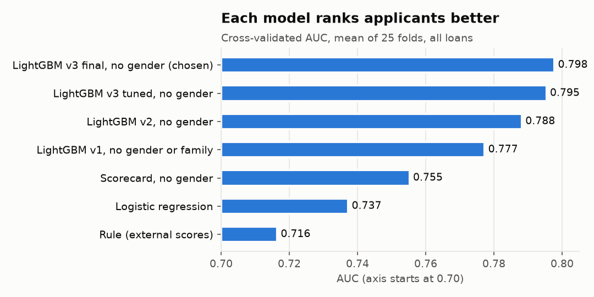
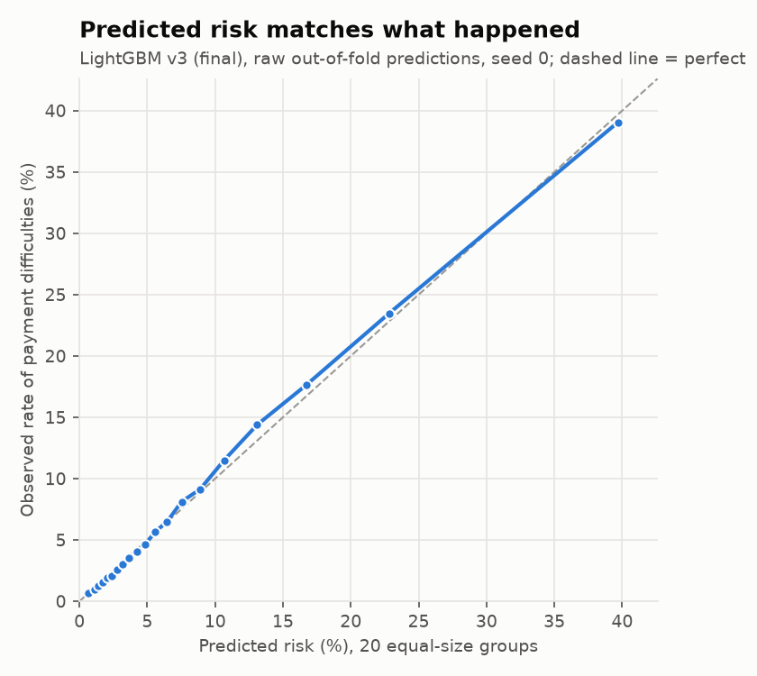
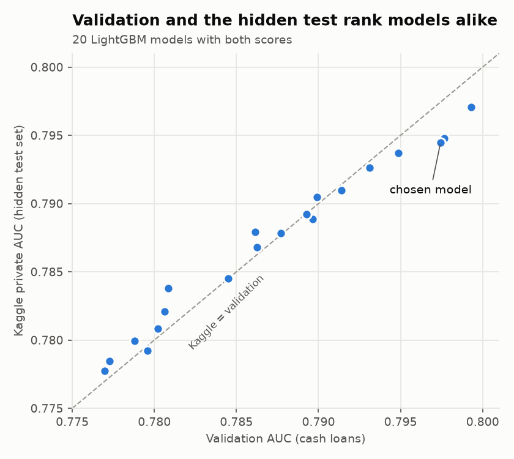
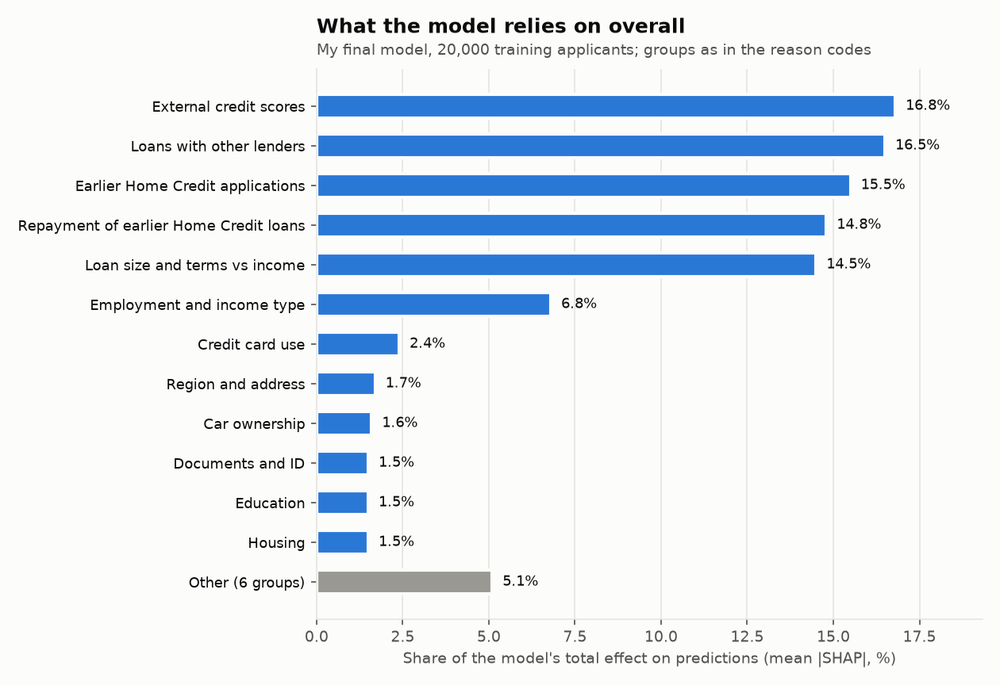
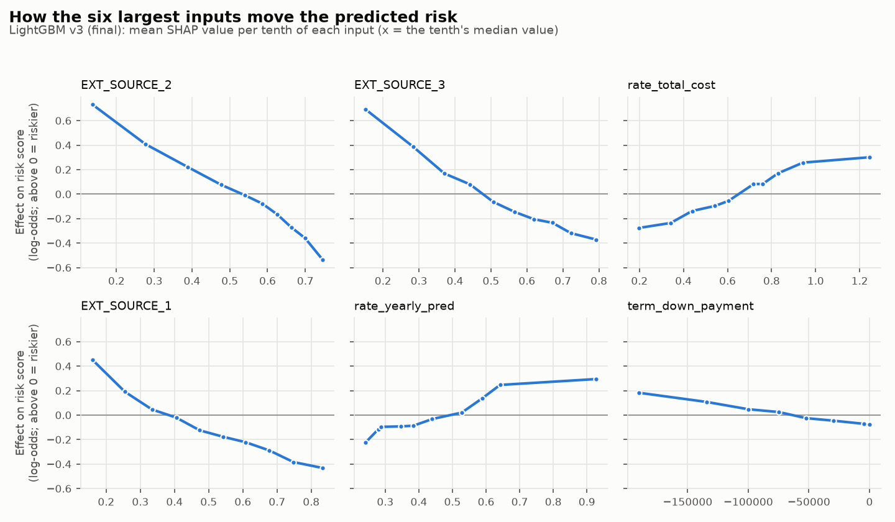
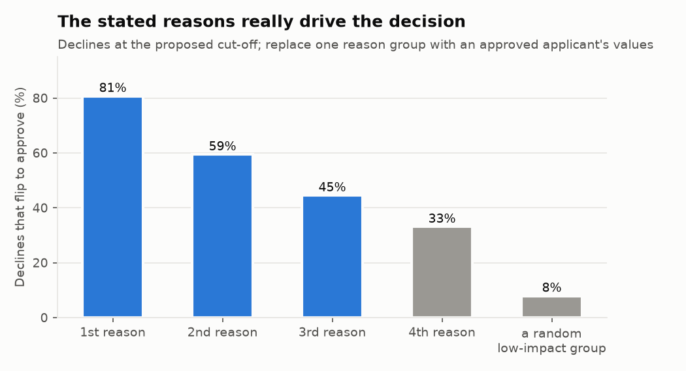
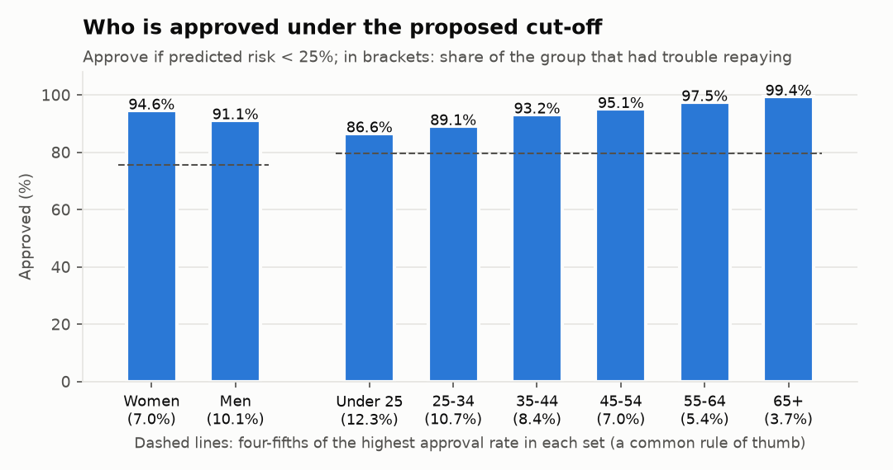
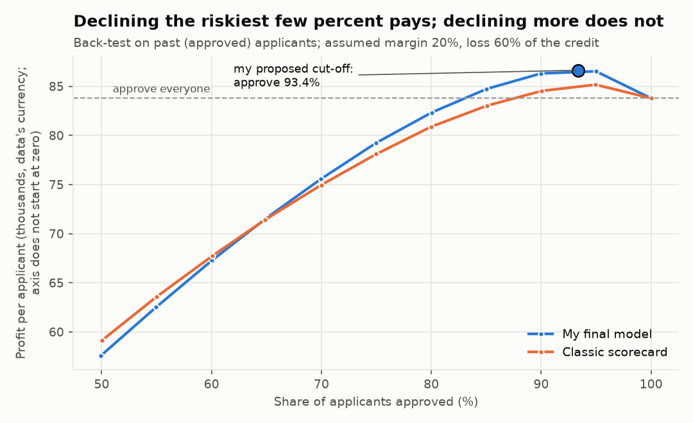

# Home Credit default risk: full write-up

This is the long version of the [README](README.md), with every caveat and the detail behind each number. The
README has the executive summary and the short story. Every number below comes from a script in this repository,
except the Kaggle leaderboard figures, which are read from Kaggle and marked as such. The
[report notebook](notebooks/home_credit_report.ipynb) has the tables behind each statement;
[`EXPERIMENTS.md`](EXPERIMENTS.md) logs every run, including what did not work, and [`OUTPUTS.md`](OUTPUTS.md)
says which script writes which result file.

## Words used below
- **AUC:** how well a model ranks people by risk. Pick one applicant who later struggled and one who repaid: AUC
  is how often the model rates the one who struggled as riskier, from 0.5 (guessing) to 1.0 (perfect). Banks
  also quote the Gini coefficient, 2 x AUC - 1 (0.596 for my final model).
- **Points:** percentage points. "0.4 points" means, for example, 8.0% instead of 7.6%.
- **Feature:** one input column the model uses, for example "share of past instalments paid late".
- **Fold:** I split the data into 5 parts; each part is predicted by a model trained on the other 4. I repeat this
  with 5 different random splits, so every comparison rests on 25 scores.
- **External credit scores:** three scores from outside providers that come with the data. Who made them and how
  is not disclosed.
- **SHAP:** a method that splits one prediction into the share each input contributed.
- **Money:** amounts are in the data's currency, which is not disclosed, per applicant, over the life of the loan.
- **Validation:** scoring each applicant with a model that never saw them (the folds above), to estimate how well
  a model works on new applicants.
- **Hidden test:** Kaggle's 48,744 test applicants, whose outcomes only Kaggle knows; it scores a submitted file.
- **Rank correlation:** whether two lists put models in the same order (1.0 = same order).

## The data and first findings
Home Credit shared 307,511 past loans with their outcome and 48,744 new applications without it (the Kaggle test
set), plus six history tables: credits with other lenders (from the credit bureau) and the applicant's earlier
applications, card statements and instalment payments at Home Credit. 8.07% of the past loans ended in payment
difficulties: "late by more than X days on at least one of the first Y instalments", with X and Y not disclosed.
This flags trouble early in the loan, and with X unknown it may not match a regulatory default definition (such as
90 days past due), so the scores are not a ready-made probability of default for capital or provisioning. All of
these loans were approved at the time, so the data says nothing about applicants Home Credit declined. The data may
only be used for the competition, so it is not in this repository.

- **The test set is a different mix, and I cannot tell whether it is later.** There are no dates, so I could not
  test "train on the past, predict the future". Test loans are almost all cash loans (lump sums repaid in fixed
  instalments), shorter and dearer: my estimate of the term has a median of 26 months in test against 36 in
  training, and of the yearly interest rate 56% against 40%. A model can tell test rows from training rows almost
  perfectly (AUC 0.96 on my first feature table, 0.98 on the final one). I dropped the bureau's monthly history and
  12 other columns that on their own tell test from train (10 summaries of instalment amounts and closing dates at
  other lenders, and 2 debt-burden ratios built on them). That choice looked at the test inputs, never at test
  outcomes.
- **Odd values hide meaning.** 365,243 days in "days employed" (1,000 years) is a code for pensioners and the
  unemployed.
- **One record teaches more than a table.** Following one applicant through every table showed a burst of
  applications and loans stacked on loans just before applying. These became features later.

## The question and my approach
Can a lender predict payment difficulties well enough to decide, and still explain each decision?

- **Validation:** one fold's score moves by 0.002 to 0.003 by chance alone. A change counts as better only if its
  gain is more than twice its noise and it wins in at least 18 of the 25 folds. The 5 splits reuse the same
  applicants, so the wins are not fully independent. When a setting was chosen on one split, I judged it only on the
  other four (at least 15 of 20 wins). That guards against luck in how the folds were cut, not against fitting the
  applicants themselves, since all five splits hold the same people.
- **Models, simplest first:** a one-line rule; logistic regression on 15 hand-picked columns; a scorecard (WOE,
  "weight of evidence": each answer on the form earns points, the way banks have scored loans for decades); and
  LightGBM (many small decision trees added together).
- **Features in steps:**
  - **v1 (149 columns):** the form plus 22 summaries of the history tables. The scorecard uses v1 only.
  - **v2 (186):** recent behaviour (the last 90 to 365 days), loan stacking (new credits elsewhere, loans still
    being repaid) and the terms of earlier loans.
  - **v3 (716 candidates):** systematic summaries of every history table, details of the latest applications,
    trends and total debt burden. Inside each training fold, SHAP keeps the fewest columns that carry 90% of the
    model's total SHAP, about 290. I fixed the 90% rule before seeing its result, but only after a first attempt
    that kept a fixed number of columns (100, 200 or 350) on one split.
  - **Loan price (5 more):** the form gives the loan amount and the monthly instalment, but not the number of
    instalments, so the interest rate is hidden. The idea comes from public write-ups of top solutions. I trained a
    small model on earlier loans whose term is known (it gets the term within 3 months for 98% of held-out loans)
    and derived the rate from the annuity formula. If Home Credit already priced loans by risk, this rate partly
    carries the lender's own earlier risk view, so it would change meaning under a new pricing policy (see Limits).

  Some ideas came from public solutions of the competition; I judged each one only on my own validation.
- **Tuning:** a bounded search of 4 LightGBM settings (20 random combinations, fixed in advance, on one split),
  confirmed on the other four splits. Learning more slowly and averaging 3 models were adopted earlier, judged on
  all 25 folds. The other model families were not tuned, so their comparison with LightGBM is not fully even.
- **Monotone constraints:** I listed 28 inputs with a clear business direction and forced the model so that a
  worse value on them never lowers the risk (for example, more late payments never make an applicant look safer).
  The SHAP cut keeps 14 of them in the final model. Related summaries that were not on the list stay free, so the
  guarantee covers the listed inputs only.

## Results
Mean of 25 folds. The last column says whether the model uses gender or family status.

| Model | AUC | Uses gender / family |
|---|---|---|
| Rule: mean of the three external scores | 0.716 | no |
| Logistic regression, 15 columns | 0.737 | gender |
| Scorecard, form and history, no gender | 0.755 | no |
| LightGBM v1, form and history | 0.779 | both |
| LightGBM v1, no gender or family | 0.777 | no |
| LightGBM v2, no gender or family | 0.788 | no |
| LightGBM v3, no gender or family | 0.794 | no |
| LightGBM v3, tuned | 0.795 | no |
| LightGBM v3, tuned, with loan price | 0.798 | no |
| LightGBM v3, tuned, with loan price, monotone (final) | 0.798 | no |

- **Each main step beats the one before in every fold it was judged on** (`comparisons/` and, for the rule,
  `validation/noise_by_fold.csv`; the scorecard steps there use the scorecard with gender, 0.001 above the one in
  the table): rule, logistic regression, scorecard,
  LightGBM v1, v2 (features +0.008, then learning more slowly and averaging 3 models +0.003), v3 (+0.006), tuning
  (+0.0017, 20 of 20) and loan price (+0.0025, 20 of 20). These gains are on all applicants; on cash loans alone the
  loan price gained +0.0028.
- **The monotone rule cost 0.0002:** within noise by my rule (the loss, 0.00023, is just under twice its noise,
  0.00024), though the constrained model won only 3 of 25 folds, so a tiny real cost is likely. When two models
  are this close, I take the one that is easier to explain.
- **What did not help:** combinations of the three external scores; the bureau's monthly payment history (no gain,
  and it covers 36% of training credits but almost all test credits); keeping more columns after the SHAP cut (95%
  or 99% instead of 90%, one split: within noise, although 95% won all 5 folds with a gain of 0.0006, just under
  twice its noise, and on Kaggle the 99% version scored 0.0016 higher; I kept the 90% rule fixed in advance); and,
  in a quick one-split check on v2, XGBoost (within noise) and a plain neural network (0.016 lower).
- **Without the external credit scores** (one split): AUC 0.768 instead of 0.790, still above the scorecard that
  uses them (0.755). A lender without these scores would lose about 0.02 AUC; the in-house and bureau history
  carry most of the signal.
- **Calibration:** predicted risk matches what happened within about 1.3 points in each of 20 score bands (on
  average 7.98% predicted against 8.07% observed); the riskier bands are slightly underestimated, for example 13.1%
  predicted against 14.4% observed. A small correction made it slightly closer.

- **The Kaggle check:** I have Kaggle scores for 21 of my submission files, all LightGBM. For the 20 that also
  have a validation score, the hidden-test order matches validation almost exactly (rank correlation 0.99, average
  gap 0.000). The difference between two models on the hidden test wobbles by roughly 0.0004 to 0.0016 by chance
  (my estimate). All 17 steps I adopted or tested moved the hidden-test score in the same direction as in
  validation, 11 by more than twice that noise. The monotone rule cost 0.0003 there (0.0002 in validation). The
  final model scores 0.7945 (validation on cash loans, the test's mix: 0.7974). I changed nothing because of
  these scores. One model's hidden-test score also carries its own sampling noise, which I cannot measure without
  the test labels, so I read the changes between models (which share much of that noise) more than any single level.
- **The gap to the hidden test grew, mostly at one step.** On the hidden test, the v1 models scored about 0.001
  above their validation, the final v2 model matched it, the tuned v3 model was 0.0011 below, and adding the loan
  price took it to 0.0029 below (final model 0.0030). The cause is unknown. One guess is optimism from making many
  choices on the same folds, but the loan price was one planned idea, not a pick among many. The order of the
  models held; the hidden-test score is the better estimate of the level.

## What the model relies on
SHAP shares over 20,000 training applicants. A large share shows what the model uses, not what causes default.

- **Five groups carry 78% of it:** external scores 17%, loans with other lenders 17%, earlier Home Credit
  applications 16%, repayment of earlier Home Credit loans 15%, and loan size and terms 15%. Age, the only
  sensitive input kept, has 1%. Read these shares as rough: each adds up its columns one by one, which favours
  groups with many related columns (70 for loans with other lenders, 3 for external scores).
- **The loan price matters.** The estimated total cost of the loan and its yearly rate are the 3rd and 5th most used
  inputs: the model gives a higher risk to dearer loans.
- **Wrong-direction answers, before the constraint:** on the 14 listed inputs that the final model uses, the same
  model without the rule lowered the risk after a worse value for 10.1% of applicants on average (median 6.5%), and
  for 38% on one input (debt with other lenders against income). Each such case is a "what if" answer that could
  confuse an applicant or a credit officer; I did not measure how large these wrong-way moves are. With the rule the
  share is 0% on all 14. I did not check the unconstrained inputs this way.

## Explaining decisions
Each declined applicant gets the three groups of inputs that pushed their risk up most (from SHAP). Numbers below
are at a cut-off that declines 6%, close to the break-even rule below.

- **The reasons drive the decision, in order.** I replaced one reason group of each declined applicant with the
  values of an approved applicant and scored again. Changing the first reason turns 81% of declines into
  approvals, the second 59%, the third 45%, the fourth 33%, and a random low-impact group 8%, in that order in all
  5 folds. This shows the reasons are faithful to the model, not that they are causes in the real world.
- **External scores dominate, but less than before.** They are the first reason for 65% of declines (v2: 81%), and
  an applicant cannot act on them, so a refusal letter should also name the first reason the applicant can act on.
  Loan size and terms, which now include the estimated price, come first for 18%. Age is among the top three
  reasons for 0.07% of declines.
- **Some defaulters look like good customers.** The quarter of the people who struggled with the lowest scores got
  4.3% predicted risk on average, below the 7.0% average of good payers (`errors_v3m/mean_pred_by_group.csv`). That
  is partly how they were picked, but it also means the model finds no warning sign for them in my inputs.

## Fairness
Decisions below use the break-even rule (decline about 6.6%) unless stated, and predicted risks are the calibrated
ones used for the money figures. The 15% check cuts on the raw score.

- **Gender:** a version of the final model that still has gender and family status scores 0.0018 higher (it wins
  all 25 folds), and 0.0026 higher on Kaggle's hidden test. In the earlier v3 model, switching only an
  applicant's gender changed 1.9% of decisions at a 6% decline rule. I removed gender and family status.
- **Removing a column does not remove the information.** The final model's candidate inputs tell men from women
  with AUC 0.91 (mostly occupation), and, even without the age columns, under 25 or not with 0.99 (mostly the date
  the ID document was issued).
- **Age helps young applicants here.** In the earlier v3 model, scored as if they were 45, more applicants under 25
  would be declined (11.8% to 16.4% at a 6% decline rule). My guess at why: a short work history looks normal at 22
  but risky at 45. An early LightGBM retrained without age (and without gender and family) agrees: it approved fewer
  under-25s (64.5% against 69.7% at a 15% decline rule) and overstated their risk (14.0% predicted, 12.3% observed).
  So I kept age.
- **It is a judgment, not a measurement.** Without gender, women's risk is slightly overstated (7.34% predicted,
  7.00% observed) and men's understated (9.49% against 10.14%), the same kind of harm that made me keep age. Many
  credit laws forbid gender as a factor and allow age under conditions; the data's country is not disclosed, so I
  name no specific law.
- **Approval gaps:** under 25: 86.6% approved, 65 and over: 99.4% (ratio 0.87); men 91.1%, women 94.6% (ratio 0.96;
  `business_v3m/policy_groups.csv`). A stricter
  cut-off widens the gap: declining 15% instead of 6.6% puts the age ratio at 0.72. A common rule of thumb, the
  four-fifths rule from US employment practice, flags ratios below 0.8: 0.87 passes it and 0.72 does not. The gaps
  remain among people who did repay (under 25 89.7% against 99.6%; men 93.8%, women 96.2%), so part of each gap
  falls on good payers.

## How the business could use this
The data has no prices or losses, so I assumed that a repaid loan earns 20% of the credit and a loan with
difficulties loses 60% of it. Approving then pays when the predicted risk is below 25% (20 / (20 + 60)). Every
applicant in the data was approved at the time, so this back-test only shows what tightening today's policy would
do. All of it is a proposal until tested live.

- **Decline the riskiest 6.6%:** the rule approves 93.4% of past applicants and cuts the difficulty rate among them
  from 8.1% to 6.1%. Profit per applicant rises from 83,782 to 86,633 (+2,851, +3.4%).
- **Score bands a credit team can use:** the safest tenth of applicants had difficulties in 0.8% of cases, the
  riskiest tenth in 31.5%. KS, the largest gap between the score distributions of good and bad payers, is 0.45
  (scorecard 0.38).
- **Share of later problem loans turned away:** declining the riskiest 10% of applicants would have declined 38.8%
  of those who later had difficulties (scorecard 32.6%), and declining 20% would have declined 58.4% (51.6%)
  (`business_v3m/approval_curve.csv`; charts `risk_by_band_v3m.png` and `declined_vs_caught_v3m.png`). Of the 10%
  declined, 68.8% would have repaid (computed from the same file in `homecredit/figures.py::caught_per_100`).
- **The assumptions matter far more than chance:** resampling applicants moves the gain only between 2,659 and
  3,034; changing margin and loss moves it between about 400 and 11,800, and the approval rate of the break-even
  rule between 77% and 99%. The model is worth most when margins are thin and losses high.
- **The later steps add little money:** against v2 the final model earns +282 per applicant (95% interval 183 to
  377). Against the tuned v3 model without the loan price it earns +68 (-3 to 132), and the monotone rule alone
  -12 (-46 to 21). Tuning added +30 (-22 to 84), measured in the tuning round's run of the same analysis. All
  three intervals include zero.
- **Where the models disagree:** applicants approved by LightGBM but declined by the scorecard had difficulties in
  18% of cases; those approved by the scorecard but declined by LightGBM in 32%.
- **What to monitor:** the score itself is stable between training and Kaggle's test set (population stability
  index 0.002, where above 0.25 usually calls for action), but the loan-price inputs shift a lot (0.84 and 0.45),
  because the test loans are shorter and dearer. A live system should watch them first.
- **Putting it to work (untested proposals):** score bands with fixed actions; refusal letters in plain words; a
  small trial next to the current rules; drift monitoring; and a small random approval sample below the cut-off to
  learn about declined applicants.

## What a credit risk team would ask
- **Where is the model weaker?** Ranking inside a group: under 25 AUC 0.752, the fifth of loans with the longest
  term 0.764, 65 and over 0.768, pensioners 0.769, against 0.798 overall. People inside one group are more alike,
  so these figures are lower by nature and not directly comparable with the overall one, but they show where to
  look first.
- **How complex is it?** 283 inputs and an average of 3 models with about 1,400 trees each. Nobody can read it
  directly; each decision is explained by its reason codes. The scorecard is the readable alternative, at about
  1,460 less profit per applicant (at its own break-even cut-off the scorecard adds 1,388 against
  approving everyone, `business_v3m/policies.csv`).
- **What does it depend on?** The three external scores, from providers whose method is unknown, carry the largest
  share; without them AUC falls by about 0.02.
- **What drifts?** The two main loan-price inputs already differ between training and test (PSI 0.84 and 0.45).
  A proposal, untested: check the term estimate on new loans each month, and refit or drop the price inputs if
  their link to risk changes.
- **Not measured:** how much the reason codes change between refits; calibration on a later period; and how the
  model would do on applicants Home Credit declined.

## Lessons learned
- **Measure the noise before comparing.** Many gains here are 0.001 to 0.003 AUC; without paired comparisons I
  could not tell them from luck.
- **Fix the decision rule before looking.** The SHAP cut, the tuning search and the monotone list were all fixed
  before their results. The tuning gain shrank from 0.0027 in the search to 0.0017 in the final setting. On the
  split that chose it, the gain was already 0.0014 at the slower final setting (the other splits: 0.0015 to
  0.0020), so most of the shrinkage goes with the change of setting. The other splits cannot show how much the
  search fitted the applicants themselves, because they hold the same people.
- **Domain knowledge beat tuning, in validation.** Estimating the hidden interest rate, an idea from public
  write-ups that rests on how loans are priced, added more (0.0025) than the whole tuning step (0.0017). On Kaggle's
  hidden test the two gained the same (0.0011 each).
- **Removing a sensitive column does not remove its effect.** Other inputs carry gender and age.
- **Test explanations, do not just display them, and get an independent review.** Swapping an input shows whether
  a reason matters; outside reviewers found that my calibration measure flattered a correction and that some
  sentences claimed too much. I fixed both.

## Limits
- **Target, time and population:** the target's exact definition is hidden; there is no time order, so random folds
  may flatter the scores; and only approved loans are in the data.
- **Business numbers rest on assumptions:** margin and loss are guesses; loan term, cures (loans that fall behind
  and then recover), funding and capital are not modelled. The margin is the same 20% for every loan, but the
  model declines dearer loans more often, and dearer loans earn more when repaid, so a flat margin likely
  overstates the gain from declining. I have not measured by how much. The numbers also use the training mix
  (9.5% revolving loans, against 0.9% in test), and every loan with payment difficulties is booked as a 60% loss,
  although the target marks early difficulties, not default.
- **External scores are opaque:** the strongest inputs come from providers whose method is not disclosed.
- **The Kaggle check is not fully independent:** some feature ideas came from public solutions that were built with
  leaderboard feedback.
- **The loan price may echo the lender's old decisions:** if Home Credit set rates by risk, part of what the model
  learns from the rate is the lender's earlier risk view. That is fine for ranking today's applicants, but a change
  in pricing policy would change what the input means. The data does not say how loans were priced.
- **Many choices on the same folds:** the SHAP cut, tuning, loan price and monotone rule were all judged on the
  same 25 folds. Validation scores after many such choices tend to be optimistic; this may explain part of the gap
  to the hidden test, but not why most of it came at one step.
- **The loan-price gain was smaller on Kaggle:** on the hidden test, adding it gained +0.0011 against +0.0028 in
  validation on cash loans, and that model scored 0.0029 below its validation score (the final model 0.0030), where
  earlier models were within about 0.001. Inside my validation the gain was only slightly smaller on test-like
  applicants (+0.0022 and +0.0023 against +0.0028 for the rest), far from the drop on Kaggle, so shorter loans and
  the applicants that look most like the test explain at most a small part. I did not test dearer loans on their
  own: my test-likeness model has no price inputs, and a tenth of test loans have an estimated yearly rate above
  98%, against 68% at the same point in training (`features/rate_drift.csv`). Chance remains possible.
- **Uneven tuning:** only LightGBM was tuned; the scorecard and the quick XGBoost and neural-network checks used
  common default settings.
- **The direct age and gender test used an earlier model:** it was measured on the untuned v3 model without the
  loan price or the monotone rule, refitted at a faster setting.
- **Possible repeat applicants:** 12,411 training rows share birth date, ID date and gender. Keeping each such group
  in one fold changed the pooled score from 0.7843 to 0.7856 (one split of an earlier v2 model). It went up, not
  down, so there is no sign that repeats flatter the score, but one split cannot settle a change this small.

## How to run
1. Download the competition data from https://www.kaggle.com/competitions/home-credit-default-risk/data with your
   own Kaggle account (accept the rules first) and unzip it into `data/raw/`. The data is not in this repository:
   the competition rules do not allow sharing it.
2. Set up Python 3.11 in a `.venv` folder at the repository root (the scripts call `.venv/bin/python`), with the
   packages in `requirements.txt`; its first lines give the commands (`uv`, and `brew install libomp` on macOS).
   One training process used up to 4.8 GB of memory, and the scripts run several at once.
3. Run `./run_all.sh` (v1 and v2), then `./run_v3.sh` (v3 up to the final model and its analyses), or pass a folder
   to either to write the results elsewhere. Without a folder they overwrite the saved results in
   `analysis_output/`. I reran both scripts into a separate folder (about 11 hours on a 10-core laptop) and compared
   every file with `experiments/check_reproduced.py` (`analysis_output/reproducibility/v3_full_rerun.csv`). Of the
   443 files both runs made, 400 match byte for byte and 34 differ only in columns that record run times. The other
   9 have a known reason. Three come from the v3 drift check, whose model came out slightly different overall
   (test-vs-train AUC 0.98236 against 0.98237) but by up to 0.33 for single rows; I have not checked why, and no
   later step reads it. Six list runs I made by hand (see `OUTPUTS.md`). The rerun first stopped because `run_v3.sh`
   lacked one run I had made by hand (the model without the external scores). I added it to the script and resumed
   from that step.
4. Open the [report notebook](notebooks/home_credit_report.ipynb) for the tables, the code layout and the
   technical details. To rebuild it: `.venv/bin/python -m notebooks.build_notebook`.
