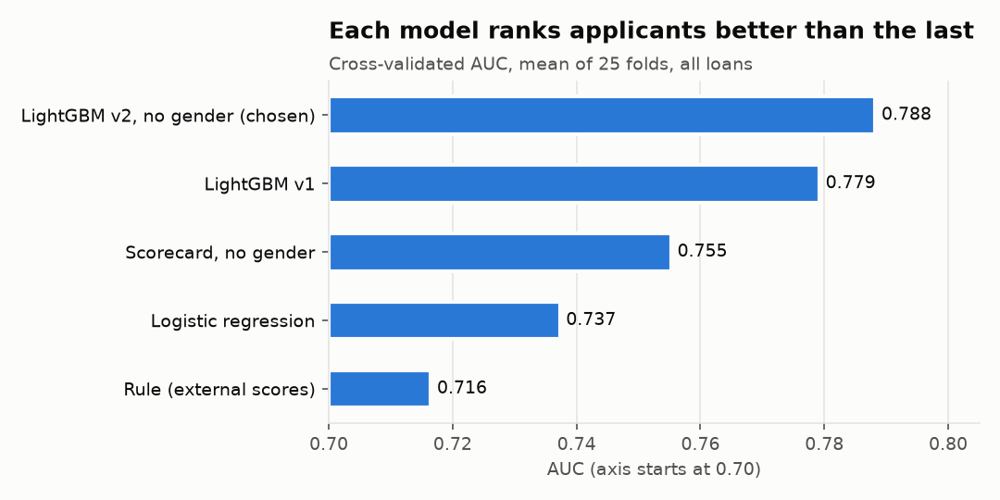
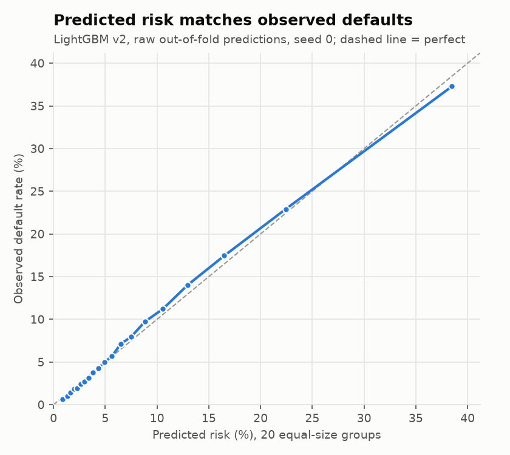
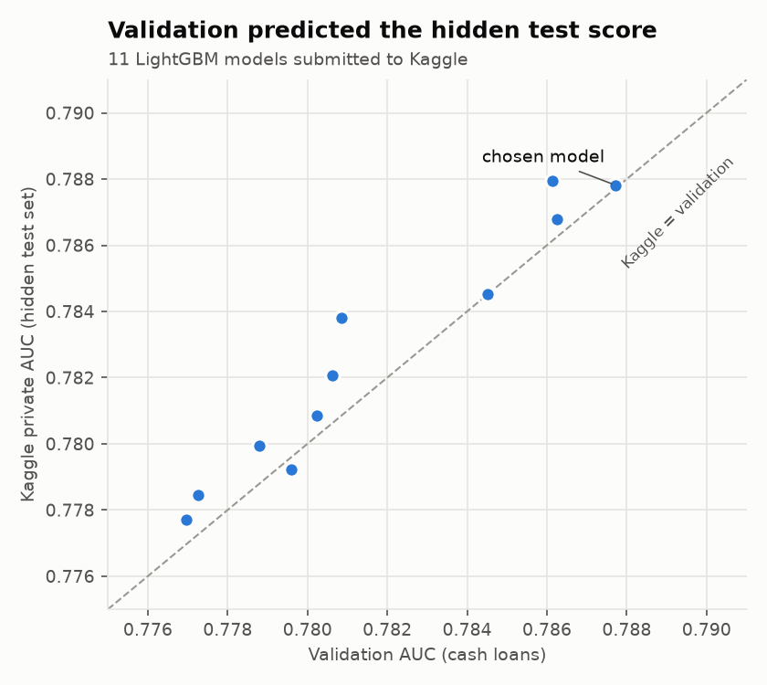
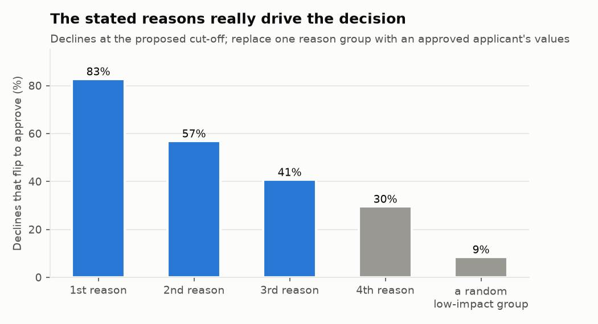
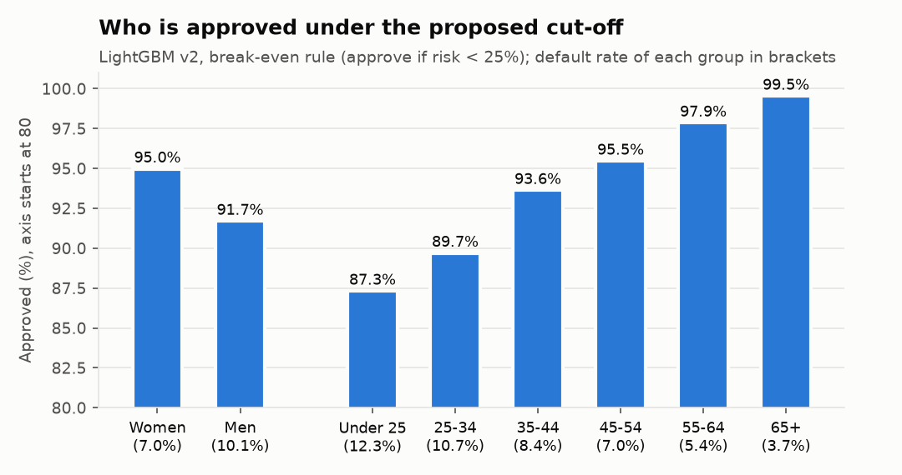
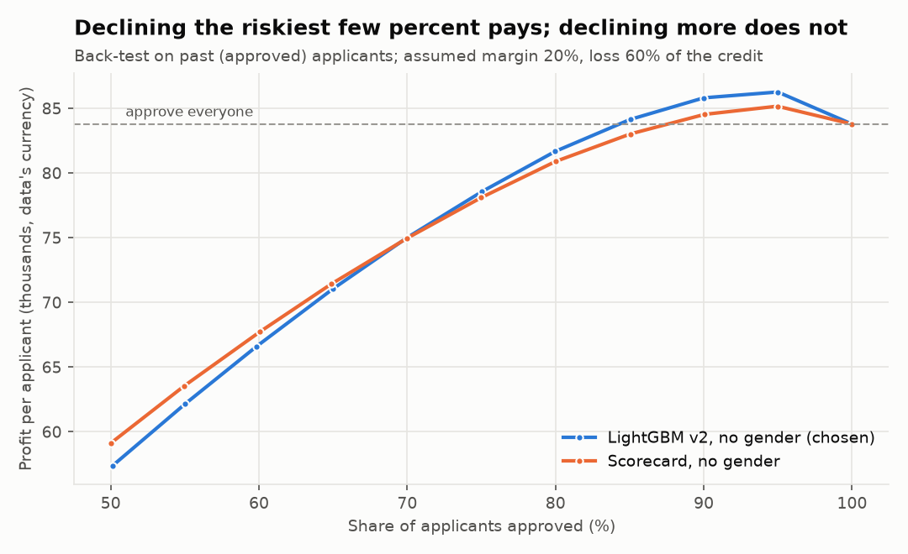

# Predicting loan default for Home Credit: accuracy, explanations and honest limits

Every number below comes from a script in this repository, except the Kaggle leaderboard figures, which are read
from Kaggle and marked as such. The [report notebook](notebooks/home_credit_report.ipynb) has the tables behind
each statement and the technical details; [`EXPERIMENTS.md`](EXPERIMENTS.md) logs every run, including what did
not work, and [`OUTPUTS.md`](OUTPUTS.md) says which script writes which result file.

## Executive summary
- **The task:** Home Credit lends to people with little or no credit history. I predict which applicants will
  have payment difficulties, from the application form and the applicants' past loans.
- **The result:** pick one applicant who later struggled and one who repaid. My chosen model rates the one who
  struggled as riskier 79% of the time; a classic bank scorecard does so 76% of the time and a one-line rule 72%.
  The model does not use gender or family status.
- **Checked on unseen data:** on Kaggle's hidden test set the model scores the same as my validation predicted, even
  though the test applicants differ from the training ones.
- **Why a lender would care (a proposal, on assumed margins and losses):** declining the riskiest 6% of applicants
  raises profit per applicant from about 83,800 to 86,400 (+3.1%), and every refusal comes with reasons.
- **The price of explainability:** the simpler scorecard would give up about 1,180 per applicant against the
  chosen model; about 810 of that remains even when both use the same inputs.
- **Fairness:** leaving gender and family status out cost 0.002 in validation and 0.003 on the hidden test (on the
  AUC scale below). It is a policy choice, not a fix: the remaining inputs still reveal gender well.

## Words used below
- **AUC:** the "79% of the time" above, written as 0.79: how well a model ranks people by risk, from 0.5 (guessing)
  to 1.0 (perfect). Banks also quote the Gini coefficient, 2 x AUC - 1 (0.576 for my model).
- **Points:** percentage points. "0.4 points" means, for example, 8.0% instead of 7.6%.
- **Feature:** one input column the model uses, for example "share of past instalments paid late".
- **Fold:** I split the data into 5 parts; each part is predicted by a model trained on the other 4. I repeat this
  with 5 different random splits, so every comparison rests on 25 scores.
- **External credit scores:** three scores from outside providers that come with the data. Who made them and how
  is not disclosed.
- **Money:** amounts are in the data's currency, which is not disclosed, per applicant, over the life of the loan.

## The data and first findings
Home Credit shared 307,511 past loans with their outcome and 48,744 new applications without it (the Kaggle test
set), plus six history tables: credits with other lenders (from the credit bureau) and the applicant's earlier
applications, card statements and instalment payments at Home Credit. 8.07% of the past loans ended in payment
difficulties: "late by more than X days on at least one of the first Y instalments", with X and Y not disclosed.
All of these loans were approved at the time, so the data says nothing about applicants Home Credit declined. The
data may only be used for the competition, so it is not in this repository.

- **The test set is a different mix, not a later period.** There are no dates, so I could not test "train on the
  past, predict the future". Test loans are almost all cash loans (lump sums repaid in fixed instalments) and
  shorter; a model can tell test rows from training rows almost perfectly (AUC 0.96).
- **Odd values hide meaning.** 365,243 days in "days employed" (1,000 years) is a code for pensioners and the
  unemployed.
- **One record teaches more than a table.** Following one applicant through every table showed a burst of
  applications and loans stacked on loans just before applying. These became features later.

## The question and my approach
Can a lender predict payment difficulties well enough to decide, and still explain each decision?

- **Validation:** one fold's score moves by 0.002 to 0.003 by chance alone. A change counts as better only if its
  gain is more than twice its noise and it wins in at least 18 of the 25 folds. The 5 splits reuse the same
  applicants, so the wins are not fully independent, but every adopted gain is at least 6 times its noise.
- **Models, simplest first:** a one-line rule; logistic regression on 15 hand-picked columns; a scorecard (WOE,
  "weight of evidence": each answer on the form earns points, the way banks have scored loans for decades); and
  LightGBM (many small decision trees added together).
- **Tuning:** no search over settings. Every model started from fixed, common settings. Only the final LightGBM got
  two changes (learning more slowly, and averaging 3 models), each adopted after it beat the noise.
- **Features in steps:** v1 has 149 columns: the form plus 22 summaries of the history tables. v2 adds recent
  behaviour (the last 90 to 365 days), loan stacking (new credits elsewhere, loans still being repaid) and loan
  terms (for example the interest rate of earlier loans). Some ideas came from public solutions of the
  competition; I judged each one only on my own validation. The scorecard uses v1 only.

## Results
Mean of 25 folds. The last column says whether the model uses gender or family status.

| Model | AUC | Uses gender / family |
|---|---|---|
| Rule: mean of the three external scores | 0.716 | no |
| Logistic regression, 15 columns | 0.737 | gender |
| Scorecard, form and history, no gender | 0.755 | no |
| LightGBM v1, form and history | 0.779 | both |
| LightGBM v1, no gender or family | 0.777 | no |
| LightGBM v2, no gender or family (chosen) | 0.788 | no |

- **Each main step beats the one before in all 25 folds:** rule, logistic regression, scorecard, LightGBM v1, v2.
- **What v2 added:** loan stacking gave the largest single gain (+0.004), then loan terms and recent behaviour
  (+0.003 each); together 0.008. Learning more slowly and averaging 3 models added another 0.003.
- **What did not help:** combinations of the three external scores; the bureau's monthly payment history (no gain,
  and it covers 36% of training credits but almost all test credits); and, in a quick one-split check, XGBoost
  (within noise) and a plain neural network (0.016 lower).
- **Calibration:** when the model says 10% risk, close to 10% really struggle. A small correction made it slightly
  closer, but it was already close.

- **The Kaggle check:** I have Kaggle scores for 11 of my 18 submission files so far, all LightGBM. Their
  hidden-test scores keep almost the same order as in my validation (rank correlation 0.96, average gap +0.001).
  Hidden-test scores wobble by roughly 0.005 by chance (my estimate), so the near-perfect match of the chosen model
  is partly luck. All 10 steps I adopted or tested moved the hidden-test score in the same direction as in
  validation, 7 by more than their noise. I changed nothing because of these scores.

## Explaining decisions
Each declined applicant gets the three groups of inputs that pushed their risk up most (SHAP values, which split a
prediction into the share of each input). Numbers below are at the proposed cut-off, which declines about 6%.

- **The reasons drive the decision, in order.** I replaced one reason group of each declined applicant with the
  values of an approved applicant and scored again. Changing the first reason turns 83% of declines into
  approvals, the second 57%, the third 41%, the fourth 30%, and a random low-impact group 9%, in that order in all
  5 folds. This shows the reasons are faithful to the model, not that they are causes in the real world.
- **External scores dominate.** They are the first reason for 81% of declines, and an applicant cannot act on them,
  so a refusal letter should also name the first reason the applicant can act on, usually repayment of earlier
  loans or loan size against income.
- **Some defaulters look like good customers.** A quarter of the people who struggled got a lower risk score than
  the average good payer. That is partly how they were picked, but it also means my inputs hold no warning sign
  for them.

## Fairness
Decisions below use the proposed cut-off (decline about 6%).

- **Gender:** in a version of the model that still has gender, switching only an applicant's gender changes 2.0%
  of decisions. I removed gender and family status.
- **Removing a column does not remove the information.** The chosen model's own inputs tell men from women with
  AUC 0.91 (mostly occupation), and, even without the age columns, under 25 or not with 0.99.
- **Age helps young applicants here.** Scored as if they were 45, more applicants under 25 would be declined (11.7%
  to 17.7%): a short work history looks normal at 22 but risky at 45. So I kept age.
- **It is a judgment, not a measurement.** Without gender, women's risk is slightly overstated (7.35% predicted,
  7.00% observed), the same kind of harm that made me keep age. Many credit laws forbid gender as a factor and
  allow age under conditions; the data's country is not disclosed, so I name no specific law.
- **Approval gaps:** under 25: 87.3% approved, 65 and over: 99.5% (ratio 0.88). A stricter cut-off widens the gap:
  declining 15% instead of 6% puts the ratio at 0.71.

## How the business could use this
The data has no prices or losses, so I assumed that a repaid loan earns 20% of the credit and a loan with
difficulties loses 60% of it. Approving then pays when the predicted risk is below 25% (20 / (20 + 60)). Every
applicant in the data was approved at the time, so this back-test only shows what tightening today's policy would
do. All of it is a proposal until tested live.

- **Decline the riskiest 6%:** the rule approves 93.9% of past applicants and cuts the difficulty rate among them
  from 8.1% to 6.3%. Profit per applicant rises from 83,782 to 86,351 (+3.1%).
- **The assumptions matter far more than chance:** resampling applicants moves the gain only between 2,381 and
  2,744; changing margin and loss moves it between about 300 and 11,000, and the best approval rate between 78% and
  99%. The model is worth most when margins are thin and losses high.
- **Where the models disagree:** applicants approved by LightGBM but declined by the scorecard had difficulties in
  18% of cases; those approved by the scorecard but declined by LightGBM in 31%. The notebook has the full score
  band table.
- **Putting it to work (untested proposals):** score bands with fixed actions; refusal letters in plain words; a
  small trial next to the current rules; drift monitoring (the score was stable between training and Kaggle's test
  set, population stability index 0.005); and a small random approval sample below the cut-off to learn about
  declined applicants.

## Lessons learned
- **Measure the noise before comparing.** Many gains here are 0.001 to 0.004 AUC; without paired comparisons I
  could not tell them from luck.
- **Removing a sensitive column does not remove its effect.** Other inputs carry gender and age.
- **Test explanations, do not just display them, and get an independent review.** Swapping an input shows whether
  a reason matters; outside reviewers found that my calibration measure flattered a correction and that some
  sentences claimed too much. I fixed both.

## Limits
- **Target, time and population:** the target's exact definition is hidden; there is no time order, so random folds
  may flatter the scores; and only approved loans are in the data.
- **Business numbers rest on assumptions:** margin and loss are guesses; loan term, cures, funding and capital are
  not modelled.
- **External scores are opaque:** the strongest inputs come from providers whose method is not disclosed.
- **The Kaggle check is not fully independent:** some feature ideas came from public solutions that were built with
  leaderboard feedback.
- **Possible repeat applicants:** 12,411 training rows share birth date, ID date and gender. Keeping each such group
  in one fold changed the score by about +0.001, within the effect of reshuffling folds, so the check is
  inconclusive at that size.
- **Next:** a third feature version with many more features and SHAP-based feature reduction is being tested
  (`run_v3.sh`); it is not part of these results.

## How to run
1. Download the competition data from https://www.kaggle.com/competitions/home-credit-default-risk/data with your
   own Kaggle account (accept the rules first) and unzip it into `data/raw/`. The data is not in this repository:
   the competition rules do not allow sharing it.
2. Set up Python 3.11 and the packages in `requirements.txt`.
3. Run `./run_all.sh` to rebuild every result, or `./run_all.sh /some/folder` to write them elsewhere.
4. Open the [report notebook](notebooks/home_credit_report.ipynb) for the tables, the code layout and the
   technical details.
