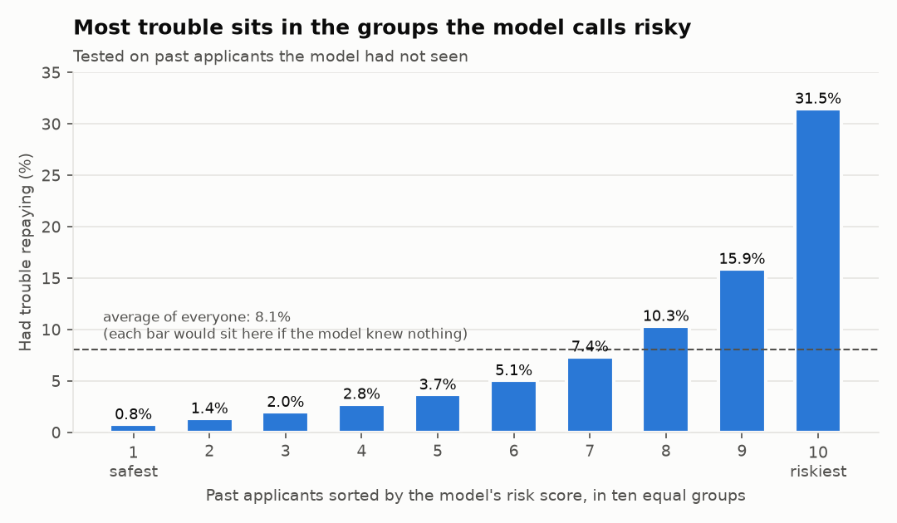
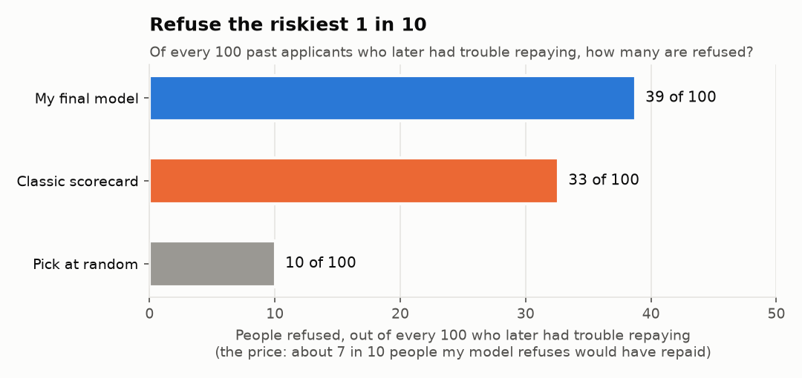
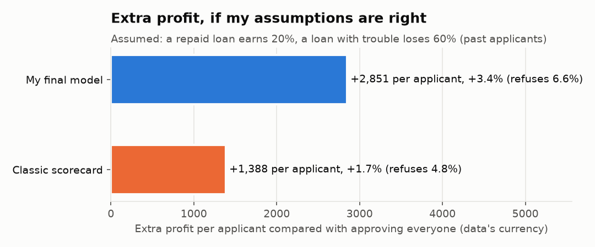
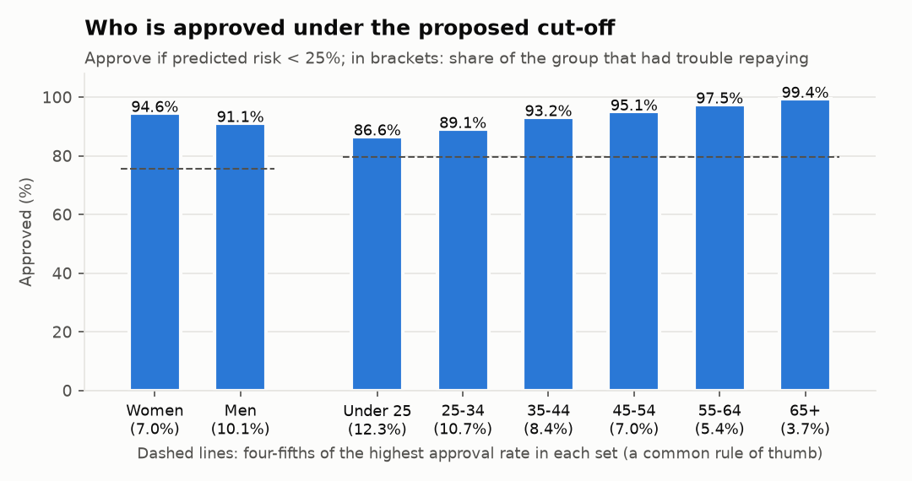
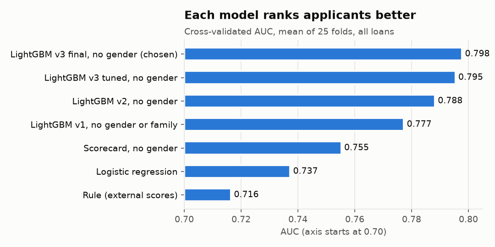
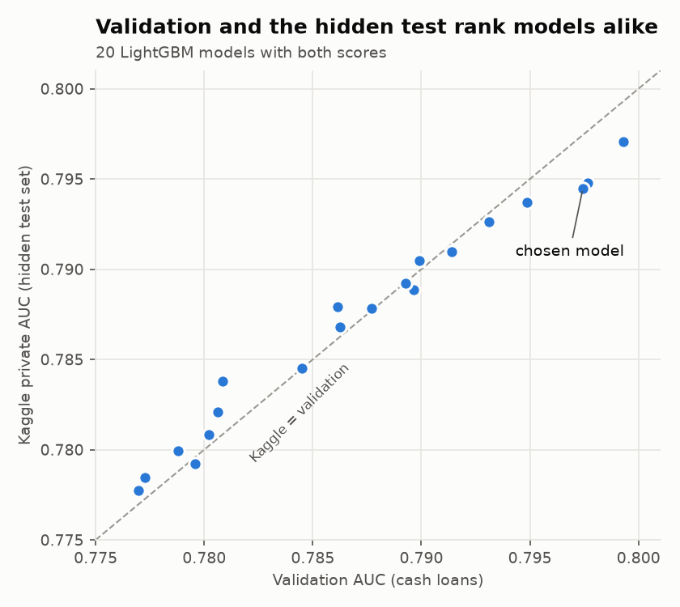
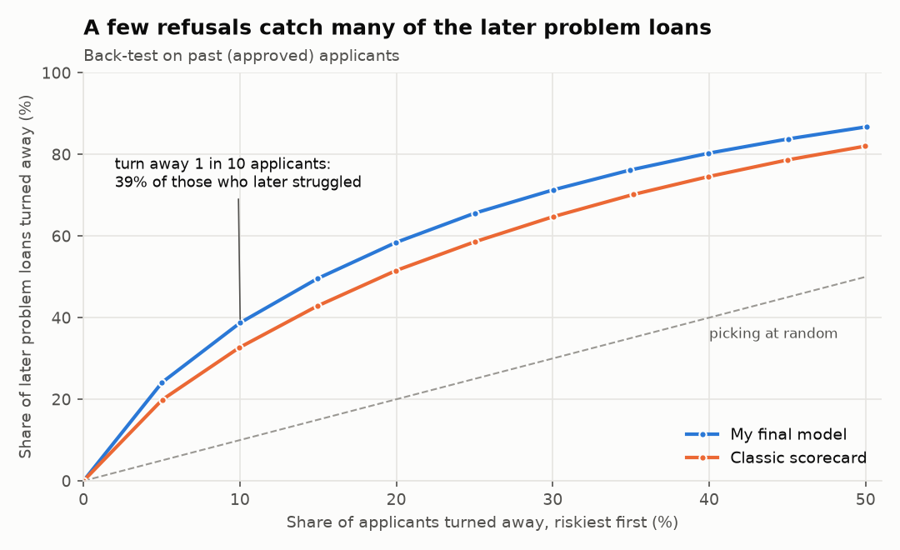
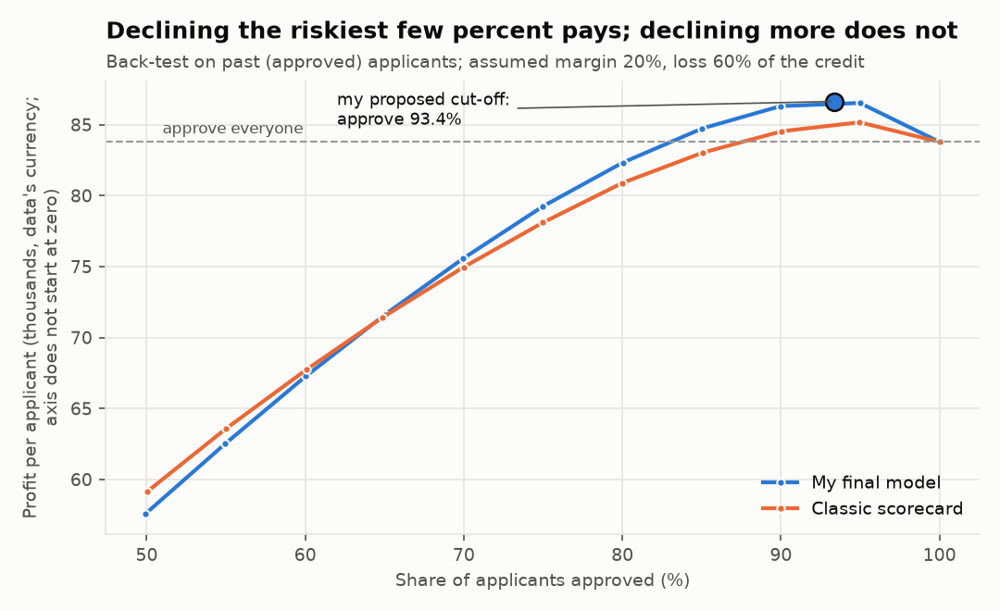
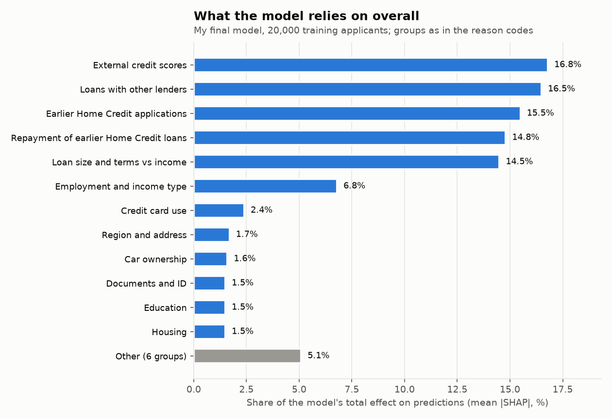

# Predicting loan default for Home Credit: accuracy, explanations and honest limits

The first half of this page is for everyone. The second half, "For technical readers", has the methods and model
scores.

## In short
Home Credit lends money to people with little or no credit history. I built a model that guesses which applicants
will have trouble repaying, gives the main reasons for each refusal, and does not use gender or family status.

- **It tells risky from safe applicants well:** take one person who later had trouble repaying and one who did not.
  In my own tests, the model picks the right one as riskier 80% of the time, a classic bank scorecard 76% and a
  one-line rule 72%. On Kaggle's hidden test of new applicants the model scored 79%, close to my own tests.
- **A few refusals catch many problem loans:** turning away the riskiest 1 in 10 applicants would have turned away
  39% of the people who later had trouble. The classic scorecard catches 33%.
- **It could make money (on numbers I assumed):** turning away the riskiest 6.6% raises profit per applicant by
  3.4%. This is an idea to test, not a tested result.
- **Every refusal comes with reasons:** each declined applicant gets the three things that raised their risk most,
  and I tested that these reasons really change the decision (see "Why each applicant is declined").
- **It follows common sense:** for 14 inputs where "worse" is clear, such as late payments, a worse value can never
  make an applicant look safer. This cost almost no accuracy.
- **Fairness is a choice, and I say so:** leaving out gender costs a little accuracy, and the other inputs still
  reveal gender. I kept age, because without it young applicants looked riskier than they really were.

## The data
Home Credit shared 307,511 past loans with their outcome, and 48,744 new applications whose outcome only Kaggle
knows (the "hidden test"). Six more tables hold each applicant's history: loans with other lenders, and earlier
applications, card statements and repayments at Home Credit. 8.07% of the past loans had trouble repaying, which
the data defines as "late by more than X days on at least one of the first Y payments" (X and Y are not given).
The data may only be used for the competition, so it is not in this repository.

- **All of these loans were approved:** the data says nothing about people Home Credit turned away.
- **The new applications look different:** almost all are cash loans, shorter and more expensive than in the
  past loans. I removed 15 columns whose values alone give away which group a loan comes from, without looking
  at any test outcomes.
- **Strange values have meaning:** 365,243 days of employment (1,000 years) is a code for pensioners and people
  without a job.
- **One person's record says a lot:** following one applicant through every table showed many applications and
  new loans just before applying. These became inputs to the model.

## How well it works

- **How to read it:** I sorted all past applicants by the model's risk score and cut them into ten equal groups.
  Each bar is the share of that group who really had trouble repaying. If the model knew nothing, every bar would
  sit at the 8.1% average.
- **Risk rises steeply:** in the safest group 0.8% had trouble repaying; in the riskiest, 31.5%, about 40 times
  more.
- **Predicted risk matches what happened:** split into 20 smaller groups (finer than the 10 in the chart), the
  predicted share with trouble was within about 1.3 percentage points of the real share. The riskiest groups are
  slightly underestimated.
- **The scores held up on Kaggle's hidden test:** the model scored a little lower there than in my own tests (79.4%
  against 79.7% on cash loans; more in "For technical readers").

- **Refuse 1 in 10, stop 39 in 100:** if the bank refused the riskiest 10% of these applicants, it would have
  refused 39 of every 100 people who later had trouble. The classic scorecard stops 33, and refusing people at
  random about 10.
- **The price:** about 7 in 10 of the people the model refuses at this cut-off would have repaid (68.8%). That is
  why the profit section below refuses fewer.
- **More refusals stop more, with less gain each time:** refusing 2 in 10 would stop 58 in 100 (the scorecard
  52).

## How a lender could use it
The data has no prices or losses, so I assumed that a repaid loan earns 20% of the amount lent and a loan with
trouble loses 60% of it. A loan then pays when its predicted risk is below 25%, which turns away about 6.6% of
applicants. All of this is an idea to test on real applicants, not a tested result.

- **Turn away the riskiest 6.6%:** among approved applicants, the share with trouble falls from 8.1% to 6.1%, and
  profit per applicant rises by about 2,850, from 83,782 to 86,633 (+3.4%, in the data's currency, which is not
  named).
- **The assumptions matter more than luck:** with other random samples of applicants, the rise stays between 2,659
  and 3,034; with other margins and losses, it moves between about 400 and 11,800.
- **Simple has a price:** the classic scorecard is easier to read, but at its own break-even cut-off it adds only
  1,388 per applicant, about 1,460 less than my model.
- **Watch the loan price:** the model's scores look the same on old and new applications, but the inputs about the
  price of a loan have shifted a lot. A live system should watch them first.
- **Start small:** fixed actions for each risk group, plain-language refusal letters, a small trial next to the
  current rules, and a few random approvals below the cut-off to learn about people who would be turned away.

## Why each applicant is declined
- **Three reasons per refusal:** each declined applicant gets the three groups of inputs that raised their risk
  most (for example "loans with other lenders" or "repayment of earlier Home Credit loans").
- **The reasons match the model's decision:** say an applicant is declined mainly because of their loans with
  other lenders. I give them the values of a randomly picked approved applicant for that group of inputs, keep
  everything else the same, and score them again. Changing only the first reason this way turns 81% of refusals
  into approvals; the second reason 59%, the third 45%. This shows the reasons match the model; it does not prove
  they cause trouble in real life.
- **Give a reason people can act on:** for 65% of refusals the first reason is the outside credit scores, which an
  applicant cannot change. A refusal letter should also name the first reason they can do something about.
- **Common-sense rules:** for each of the 14 listed inputs, I made the value a little worse and scored 20,000
  applicants again. Without the rules, the predicted risk went down for 10.1% of applicants, averaged over the 14
  inputs. With them, this never happens on those 14. Related inputs not on the list are not covered.

## Fairness
- **No gender or family status:** keeping them would make the model only very slightly better (80.0% instead of
  79.8% in my tests). Removing them does not remove the information: the other inputs can still tell men from
  women quite well.
- **Age kept:** an early model without age overstated the risk of people under 25 (14.0% predicted, 12.3% real).
  Keeping age but not gender is my own judgment.
- **Approval gaps remain:** at the 6.6% cut-off, 86.6% of people under 25 are approved against 99.4% of people 65
  and over. Dividing one by the other gives 0.87. A common rule of thumb (the "four-fifths rule") flags a ratio
  below 0.8, so this passes. For men and women (91.1% against 94.6%) the ratio is 0.96. A stricter cut-off that
  turns away 15% would bring the age ratio to 0.72, which would not pass.

## Limits
- **The definition of trouble is hidden** and may not match a bank's legal definition of default (for example 90
  days late).
- **No dates:** I could not test "learn from the past, predict the future".
- **Only approved loans:** the model has never seen the people who were turned away.
- **Profit numbers rest on my guesses** about margin and loss.
- **The outside credit scores are a black box:** they are the strongest inputs, and how they are made is not known.
- **The model did a little worse on Kaggle than in my tests,** mostly after I added the loan price, and I do not
  know why.

The full list is in [`DETAILS.md`](DETAILS.md#limits).

## Lessons learned
- **Measure luck before comparing:** many improvements here are tiny; without repeated tests I could not tell them
  from chance.
- **Set the rules before looking at results:** how many inputs to keep, the tuning search and the common-sense list
  were all fixed in advance.
- **Knowing the business beat tuning:** in my tests, working out the hidden interest rate of each loan helped more
  than tuning the model's settings (on Kaggle the two helped about the same).
- **Removing a sensitive column does not remove its effect:** other inputs carry gender and age.
- **Test the explanations and get a second pair of eyes:** changing an input shows whether a reason matters, and
  outside reviewers caught sentences that claimed too much.

## For technical readers

### Words used here
- **AUC:** the "80% of the time" above, written as 0.80. It runs from 0.5 (guessing) to 1.0 (perfect). Banks also
  quote the Gini coefficient, 2 x AUC - 1 (0.596 for my final model).
- **Validation:** scoring each applicant with a model that never saw them. I split the data into 5 parts (folds),
  predict each part from the other 4, and repeat with 5 random splits, so every comparison rests on 25 scores.
- **SHAP:** a method that splits one prediction into the share each input contributed.
- **Monotone constraint:** the "common-sense rule" above: the model may not lower the risk when a listed input gets
  worse.

### Approach
- **Measure the noise first:** one fold's score moves by 0.002 to 0.003 by chance. I adopt a change only if its
  gain is more than twice its noise and it wins in at least 18 of the 25 folds. A setting chosen on one split is
  judged only on the other four.
- **Simplest model first:** a one-line rule, logistic regression, a scorecard (WOE, "weight of evidence": each
  answer on the form earns points, the way banks have scored loans for decades), then LightGBM (many small decision
  trees added together).
- **Features in steps:** the application form plus summaries of the history tables, then recent behaviour and loan
  stacking, then systematic summaries of every table. Inside each training fold, SHAP keeps the fewest columns
  that carry 90% of the model's total SHAP (283 in the final model).
- **The hidden loan price:** the form gives the loan amount and the monthly payment, but not the number of
  payments. I estimated the term with a small model and derived the interest rate. The idea comes from public
  write-ups of top solutions; I judged it, like every idea, only on my own validation.
- **Fixed before looking:** a small tuning search, and a list of 28 inputs for monotone constraints, of which the
  final model uses 14.
- **Kept out because of drift:** a model can tell test rows from training rows almost perfectly (AUC 0.98 on my
  final feature table). I dropped 15 columns that on their own tell them apart, looking at test inputs only.

### Model comparison
Mean of 25 folds. The last column says whether the model uses gender or family status.

| Model | AUC | Uses gender / family |
|---|---|---|
| Rule: mean of the three external scores | 0.716 | no |
| Logistic regression, 15 columns | 0.737 | gender |
| Scorecard, form and history, no gender | 0.755 | no |
| LightGBM v1, no gender or family | 0.777 | no |
| LightGBM v2, recent behaviour and loan stacking | 0.788 | no |
| LightGBM v3, all tables, tuned | 0.795 | no |
| LightGBM v3, tuned, with loan price, monotone (final) | 0.798 | no |

- **Each main step beat the one before in every fold it was judged on:** rule, logistic regression, scorecard,
  LightGBM v1, v2, v3, tuning and loan price. The monotone rule then cost 0.0002, within noise; when two models
  are this close I take the one that is easier to explain.
- **What did not help:** the bureau's monthly payment history, combinations of the external scores, XGBoost
  (within noise) and a plain neural network (0.016 lower).
- **Without the external scores** AUC falls from 0.790 to 0.768 (one split), still above the scorecard that uses
  them. The credit history at Home Credit and other lenders carries most of the signal.
- **Gender and family status:** a version with them scores 0.0018 higher in validation and 0.0026 on Kaggle. The
  remaining candidate inputs tell men from women with AUC 0.91.

### Check on Kaggle's hidden test

- **The order of models holds:** across 20 models, the hidden test ranks them almost as my validation does (rank
  correlation 0.99). All 17 steps I adopted or tested moved the hidden-test score in the same direction.
- **The level is a little lower:** the final model scores 0.7945 on Kaggle against 0.7974 in validation on cash
  loans (the test's mix). Most of that gap appeared when I added the loan price; the cause is unknown. I changed
  nothing because of Kaggle scores.

### Every cut-off, not just one
The two plain charts above show one cut-off each. These curves show all of them.

- **Refusals against problem loans caught:** left to right, the bank refuses more applicants, riskiest first; the
  height is the share of all later problem loans refused. The dashed line is refusing at random.
- **Profit:** profit per applicant at each approval rate. It peaks when about 93% are approved; refusing more also
  loses good customers.

### What the model relies on

- **Five groups carry 78% of the SHAP share:** external scores, loans with other lenders, earlier Home Credit
  applications, repayment of earlier Home Credit loans, and loan size and terms. A large share shows what the model
  uses, not what causes default.

## More detail
- [`DETAILS.md`](DETAILS.md): the full write-up, with every caveat and the source file of each number.
- [Report notebook](notebooks/home_credit_report.ipynb): the tables behind the statements.
- [`EXPERIMENTS.md`](EXPERIMENTS.md): every run, including what did not work.
- [`OUTPUTS.md`](OUTPUTS.md): which script writes which result file.

Every number on this page comes from a script in this repository, except the Kaggle scores, which I read from
Kaggle.

## How to run
1. Download the data from https://www.kaggle.com/competitions/home-credit-default-risk/data with your own Kaggle
   account (accept the rules first) and unzip it into `data/raw/`. The competition rules do not allow sharing it.
2. Set up Python 3.11 in `.venv` at the repository root with the packages in `requirements.txt` (its first lines
   give the commands). One training process uses up to 4.8 GB of memory, and the scripts run several at once.
3. Run `./run_all.sh` (v1 and v2), then `./run_v3.sh` (v3 and the final model). Pass a folder to either to write
   the results there; without one they overwrite the saved results in `analysis_output/`. A full rerun took about
   11 hours on a 10-core laptop and reproduced the saved files, apart from run times and a few known differences
   ([details](DETAILS.md#how-to-run), `analysis_output/reproducibility/v3_full_rerun.csv`).
4. Rebuild the [report notebook](notebooks/home_credit_report.ipynb) with
   `.venv/bin/python -m notebooks.build_notebook`.
